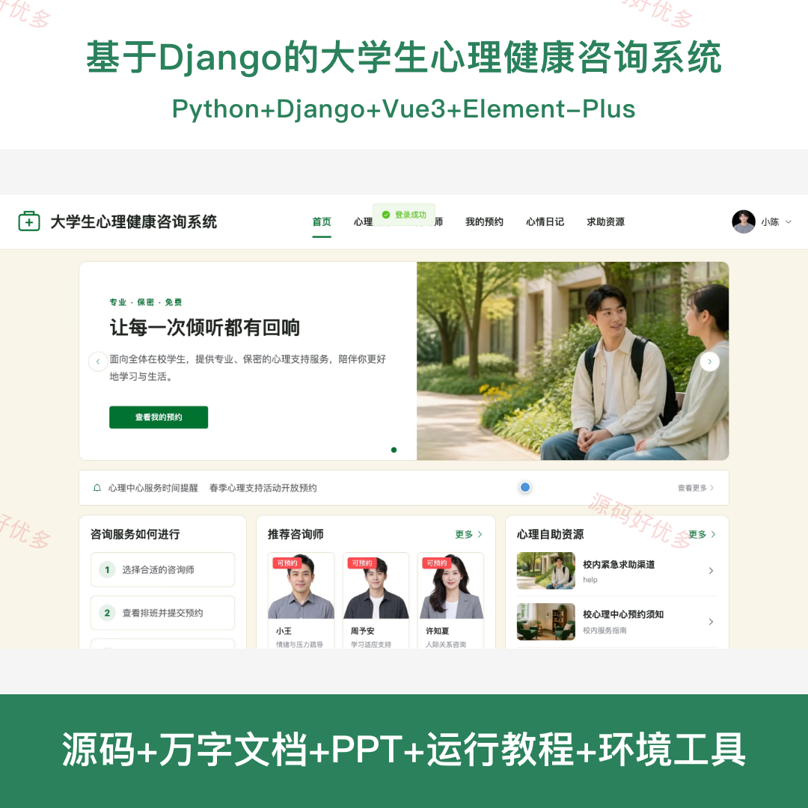
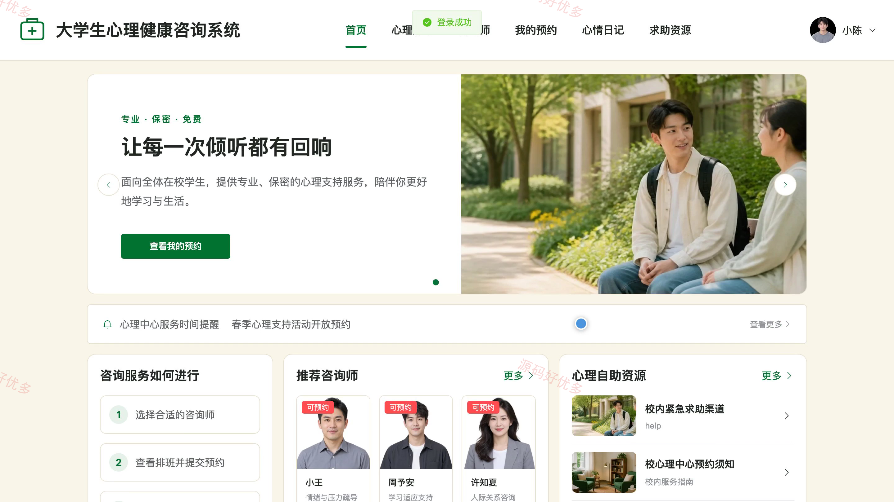
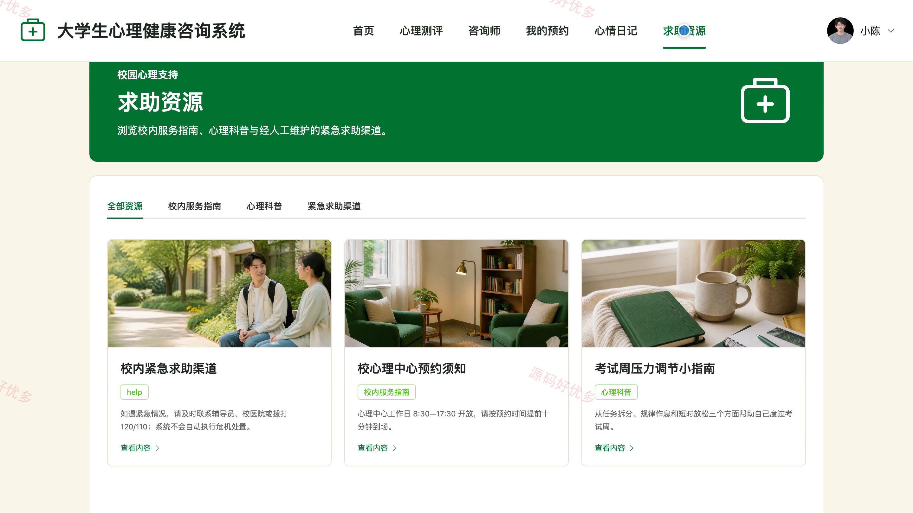
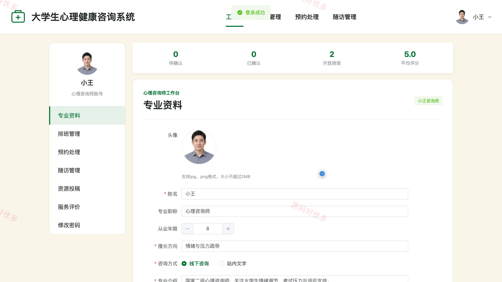
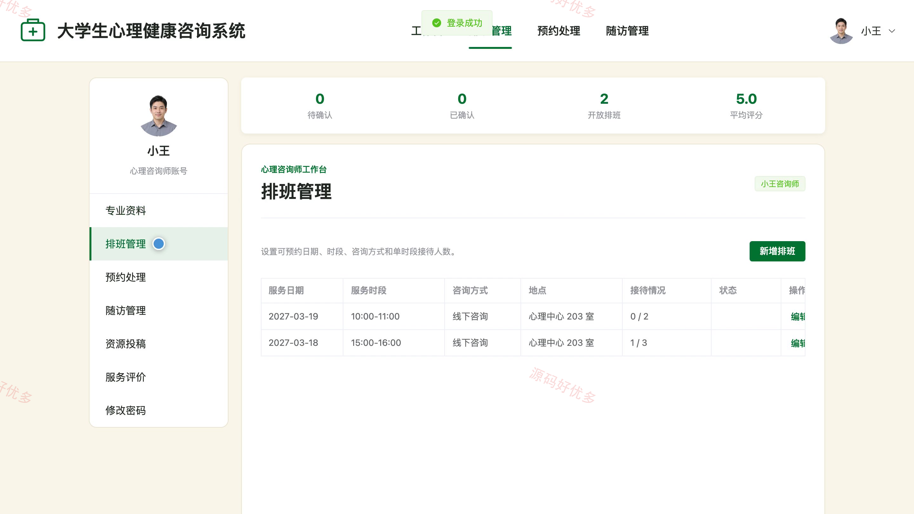
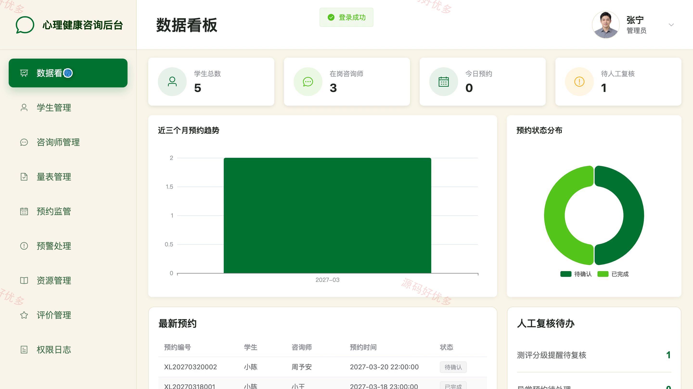
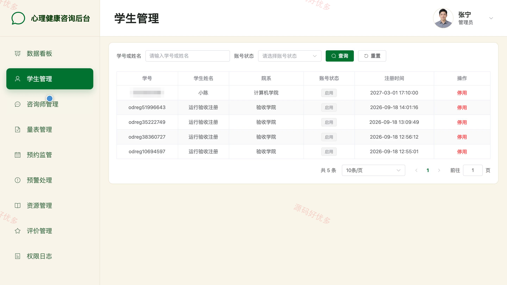
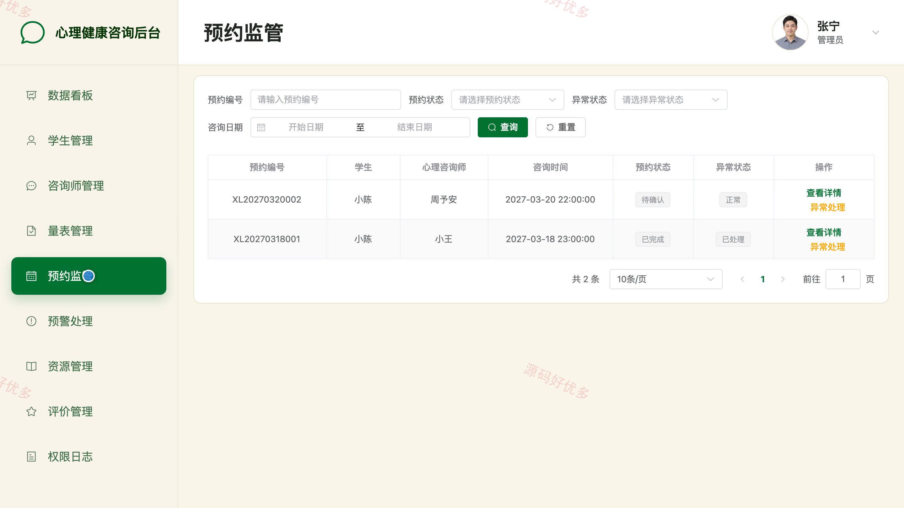
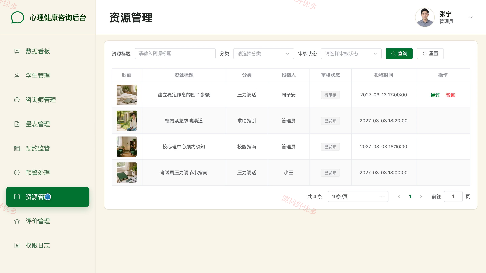

# bs110C
bs110C大学生心理健康咨询系统
## 源码问题查看主页咨询

### 一、关键词
心理咨询服务、心理测评、咨询预约、情绪管理、校园心理支持

### 二、作品包含
源码+数据库+万字设计文档+PPT+全套环境和工具资源+本地部署教程

### 三、项目技术
前端技术： Html、Css、Js、Vue3.4、Element-Plus
后端技术：Python、Django

### 四、运行环境要求
开发工具：PyCharm + VSCODE

数据库：MySQL5.7+（共21张表）

数据库管理工具：Navicat10以上版本

环境配置软件： Python3.9+

前端Nodejs：16+

浏览器：谷歌浏览器

### 五、项目介绍
项目编号：bs110C

该系统面向高校学生心理支持场景，为学生、心理咨询师和管理员提供分角色服务入口。学生可以查询咨询师、提交咨询预约、参与非诊断性心理测评、记录心情日记并查看求助资源；心理咨询师可以维护专业资料和排班，处理预约、咨询记录与随访任务；管理员负责学生账号、咨询师资质、心理量表、预约异常、预警记录、求助资源和服务评价等业务管理。

角色：学生、心理咨询师、管理员

学生功能：学生注册、心理咨询师查询、心理测评与结果查看、咨询预约与进度查看、站内咨询交流、服务评价、心情日记管理、个人资料维护。

心理咨询师功能：专业资料维护、排班管理、预约处理、站内咨询交流、咨询记录管理、测评摘要查看、随访管理、修改密码。

管理员功能：数据看板与权限日志、学生账号管理、咨询师资质管理、心理量表管理、预约监管与异常处理、预警人工复核、求助资源审核管理、服务评价管理。

### 六、运行截图

